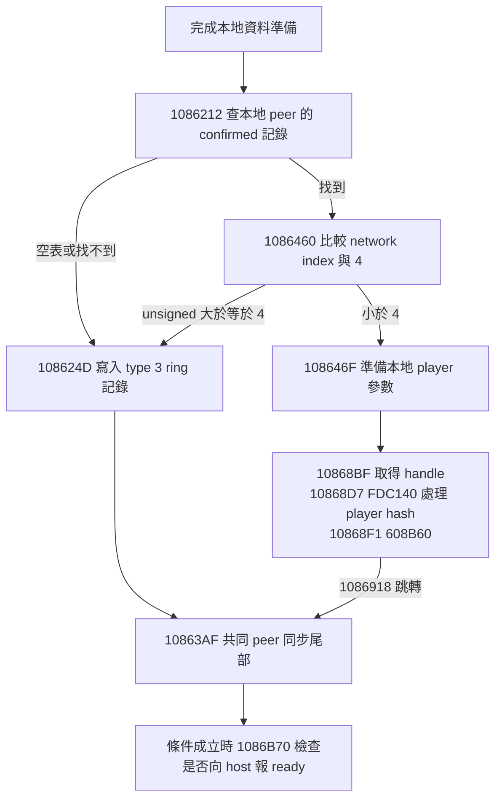

# 本地 player 建立前的 network-index gate：完整正常路徑

## 結論

`0x1086460/0x1086469` 的 `<4` 是 **ClientSynchronizer 收到 `from_host_added_to_session` 後，本地 player 資源建立路徑的必要條件**。它不只是保護前面的 loadout／history 資料，也不只是選擇 UI 顯示。沿用此正常加入路徑時，索引 4–7 必须能進入等效的 player 建立流程；需要調整此條件或提供經驗證的替代路徑。

這個「必要」限定在已解析的函式正常入口及其現有實作。它不表示遊戲中絕無另一個建立入口，也不表示改成 `<8` 就足夠。房主／客戶端記錄、roster 及元件容量仍各自需要擴容。

本次完全離線：[local_player_creation_gate_replay.py](local_player_creation_gate_replay.py) 重新核對原始捕捉 SHA，解析 [local_player_creation_gate_evidence.json](local_player_creation_gate_evidence.json)。主函式六段相連的 unwind fragments 共 **565 條指令**；所有正常控制流程邊都落在已證明的指令邊界。沒有使用 live/query/probe。

## 1. 函式與 base 來源

主函式正常入口為 **`0x1085D70`**，完整相連 fragments 結尾為 `0x108691D`。它保存 entry RCX 為 R15，entry RDX 為待處理 peer/sender 值。

`0x1085DC7` 與 `0x1085DD6` 明確引用保存字串：

```text
from_host_added_to_session
ClientSynchronizer
```

入口先以 `[client]` 取得 owner；entry RDX 必須等於 `owner+0xB3A8`，或 client `+0x51A` 的 byte 非零，才繼續。若兩者都不滿足便回傳。這是前置條件，不能略過。此分析沒有將 `+0x51A` 命名成任何已證實旗標語義。

既有 constructor pins 同時重新保存：`0x134D754` 取得 owner global **`0x347CEF0`**，`0x134DD07` 形成 embedded client **`owner+0x162C8`**，`0x134DD28` 安裝 owner backpointer。因此 confirmed-peer 表可換算為：

| 欄位 | 相對 owner | 相對 client |
| --- | --- | --- |
| count | `+0x16390` | `+0xC8` |
| peer ID，第 i 筆 | `+0x16398+i*0x20` | `+0xD0+i*0x20` |
| network index，第 i 筆 | `+0x163AC+i*0x20` | `+0xE4+i*0x20` |

在本函式 **`0x1086212`** 再次取得同一 owner global，`0x1086228` 取得 `owner+0xB398` 的本地 peer ID；`0x1086238` 逐筆比較 confirmed-peer ID。因此 guard 比較的是**本地 peer 的 network index**，不是 roster ordinal、未解析的 UI 槽位或名單 count。

## 2. Loadout／history 分支在 gate 之前已合流

`0x1085EE7` 起依 client 狀態欄位選擇資料準備方式。重返情境分支有明確日誌：

> Found history, player is rejoining a previous game. Loadout is overridden with previous data.

其主要兩條路徑是：

- 使用 history 資料並複製到 stack `+0x15B0`；經 `0x1086190` 或 `0x10861C1` 到 `0x1086212`。
- `0x10861C3` 的另一條查找／複製路徑；空資料、未命中及成功複製都合流到 `0x1086212`。

所以 `<4` **位於這些路徑的共同後續**。它沒有只包住重返 loadout 的那一個分支。後面 accepted 路徑以 stack `+0x15B0` 為輸入呼叫資料準備 helper `0x515BB0`，再準備 player creation params；helper 的返回資料來源可見，但內部呼叫不是本 CFG 的完整展開範圍。

## 3. 三個 fallback 條件與 accepted 路徑



guard 的連續指令為：

```text
0x108645C  shl rdx, 5
0x1086460  cmp dword ptr [rdx+r8+0x163AC], 4
0x1086469  jae 0x108624D
0x108646F  accepted 分支開始
```

這裡是 unsigned 比較，`0xFFFFFFFF` 等 sentinel 也落到 fallback。擴容不能把這段當成可無條件刪除的錯誤檢查；未找到記錄和不合法索引仍需要拒絕建立。

### Accepted 路徑確實包含 player 資源處理

`0x108646F..0x108691D` 區間內沒有另一個會略過下列呼叫的条件分支；主要的內部分支只是固定次數的資料複製 loop。若函式呼叫都正常返回，就會到達：

1. `0x10868BF`：以 dummy hash 呼叫先前已解析的 handle 介面。
2. `0x10868D7`：用該回傳值及 **`content/entities/player` hash `0xCDC1F82CE3337A82`** 呼叫 `0xFDC140`。
3. `0x10868F1`：把同一回傳值交給 `0x608B60`，RCX 來自 roster global `0x3326468`。
4. `0x1086918`：直接跳到 **`0x10863AF`**，跳過 fallback ring 寫入區間。

這與既有「player creation params 首 byte = 1 → FDC140 → 元件 callback」的證據相容。本頁並未把資源 hash 與目前 installed/runtime metadata 等價性提升為已驗證，也没有重新宣稱下游成功執行。

## 4. 索引 4–7 跳過建立後，函式如何繼續

`0x108624D` 取得另一個 global **`0x346D560`** 指向的物件，準備一份 **type 欄位 = 3** 的記錄，寫入：

```text
queue + 0x200 + queue.write_index * 0xE8
```

寫指標 `+0x1FC` 以 `&0x1F` 繞回；如果碰到 `+0x1F8` 的讀指標，也將讀指標推進。這是 **32 筆的 ring 寫入**，不是玩家陣列。記錄的消費者與對玩家可見的意義尚未識別，不能先命名成特定錯誤訊息或 UI 提示。

Fallback 完成後到 `0x10863AF`，與 accepted 路徑合流。共同尾部會枚舉平台 peers，對非本地、符合平台條件的 peers 經 `0x1086920` 建立／取得 client `+0x38/+0x40` 的同步狀態記錄；這些是 16-byte peer 狀態記錄，並非另一個 `FDC140` player 資源建立呼叫。

若本地 peer ID 不等於 entry sender 值，`0x108643C` 呼叫 **`0x1086B70`**。該 helper 的完整 257-byte 保存程式顯示：

- 檢查及移除同步完成的 peer 狀態記錄。
- 全部同步完成時，日誌為 **「All peers have synced, sending to host that we are ready.」**。
- 發送 hash `0x37FF1AA7` 到 owner `+0xB3A8` 的 peer，並可將 client `+0x1D0` 設為 5。

因此不能以「此函式照常返回／繼續 ready 流程」推論本地 player 已建立。對索引 4–7，這個 root 的正常 fallback 路徑**可繼續同步尾部，卻不執行它唯一的 player 資源處理呼叫**。

## 5. CFG 證明與「已有 entity」問題

Replay 對全部 565 條指令建立正常 CFG，不把 call 目的地併入圖；call 被視為正常返回。結果確認：

- 主入口可到達 `0x10868BF` 與 `0x10868D7`。
- 若移除唯一的 accepted 邊 **`0x1086469 → 0x108646F`**，兩個呼叫從主入口都不可達。
- 從 fallback `0x108624D` 出發，兩個呼叫都不可達。
- Accepted 路徑不可到達 fallback ring 寫入起點。
- 本 root 只有一個直接 `FDC140` call。
- Accepted 與 fallback 路徑均可到達共同 ready-helper call。

本 root 沒有在 guard 前檢查「本地 player entity 已存在」並據此進入另一個建立／沿用分支的直接證據。已看到的查找分別是 history/loadout、confirmed peer ID 和平台 peers；不能把它們當成 entity-exists guard。這是對本函式已解析正常程式的結論，**不涵蓋所有被呼叫函式、例外流程、其他遊戲入口或動態修改**。

## 對八人實作的決策

這個 guard 應列入**必須讓 index 4–7 得到等效本地 player 建立的修改點**，不是僅改善 UI 的可選項。保留現有加入路徑時，僅擴大 confirmed-peer count 或 host 允許人數，仍會讓索引 4–7 走到此 fallback。

但此處尚不宜單獨套用 `<8` 修改：accepted 路徑會立即觸及 player 元件、roster 及其他索引儲存，原生四筆布局尚需同步擴容。最終仍需在第五位實際玩家上驗證 handle／player 元件成功建立、同步、復活及結算；本分析未做這些測試。

重播（輸出須為新路徑）：

```powershell
python -B five_player_feasibility_20260927/local_player_creation_gate_replay.py --evidence 'C:\Users\OvO\Documents\Codex\2026-09-26\referenced-chatgpt-conversation-this-is-an\outputs\healing-pistol-enhanced\build\existing-code-evidence-25480438' --output NEW-local-player-gate.json
```
